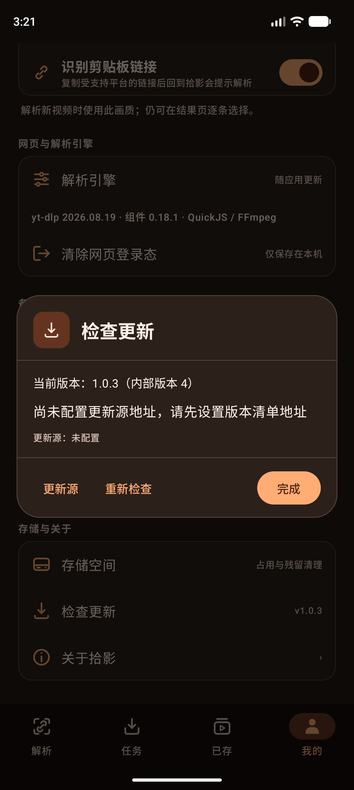
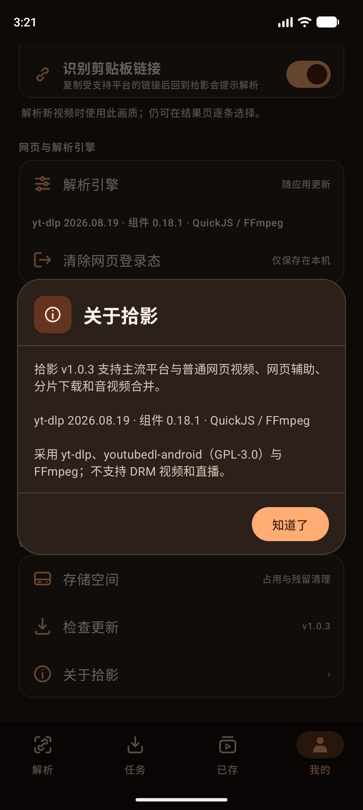
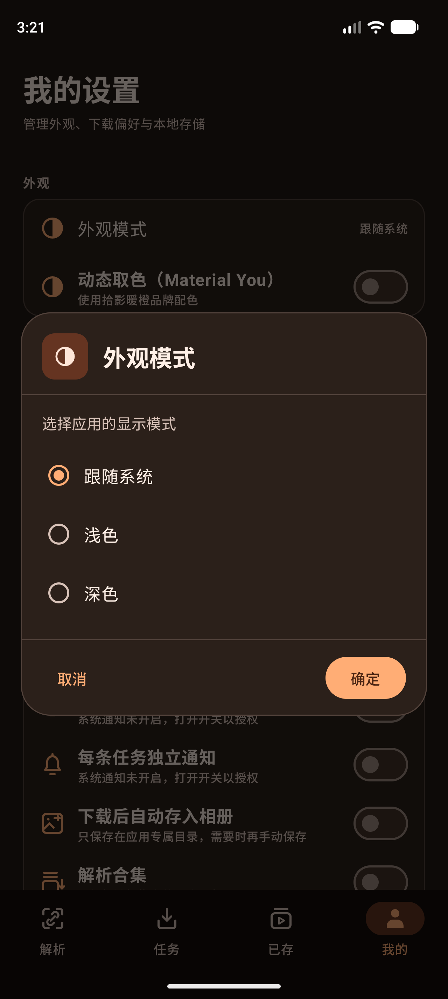
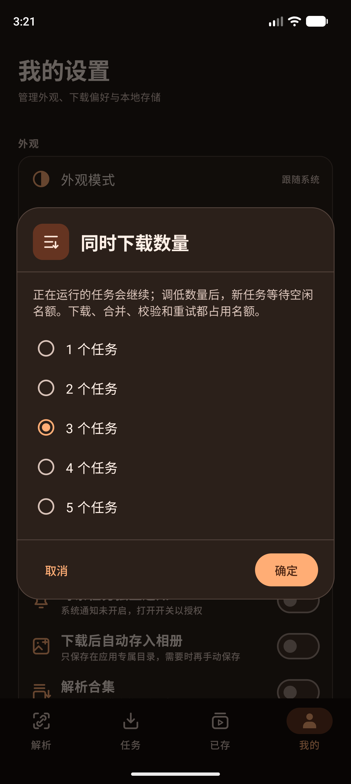
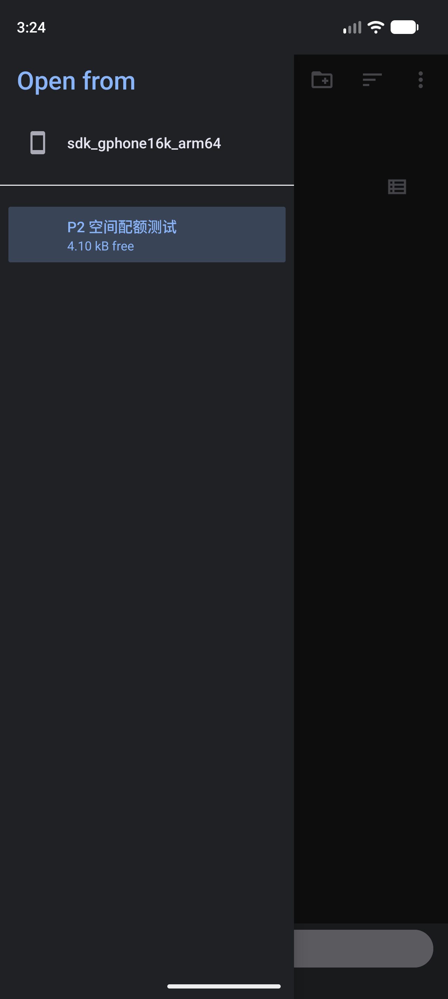

# AppDialog：卡片式弹窗骨架与全应用统一（2026-10-10）

## 目标

上一轮把「存储管理」重做成卡片式弹窗后，其余 13 个文件里还有 23 处 `AlertDialog`：同样是 M3 默认的
纯文字弹窗，标题、正文、按钮的字重与间距各写一遍，「检查更新」「关于拾影」这些常用弹窗与存储弹窗
明显不是同一套观感。本轮把这套结构抽成可复用骨架，并把全部调用点迁过去。

## 实现

### 新增 `presentation/components/AppDialog.kt`

- `AppDialog(onDismissRequest, icon, title, subtitle, maxHeightFraction, actions, content)`：
  图标块 + 标题（可选副标题）头部、可滚动正文、固定在底部的动作行。高度上限取当前窗口高度的 86%，
  正文列 `weight(1f, fill = false)`——内容放得下就整段展示，放不下才滚动，按钮永不被挤出屏幕。
- `AppDialogButtonRow { ... }`：底部动作行，次操作靠左、推进型操作靠右，中间用
  `Spacer(Modifier.weight(1f))` 分组。
- `AppDialogRadioRow(selected, onSelect, minHeight, label)`：统一 48–64dp 起步高度、圆角与单选语义，
  放进 `Column(Modifier.selectableGroup())` 即成一组单选。
- `AppConfirmDialog(...)`：正文一句话 + 一行「取消 / 确认」的确认弹窗，`dismissText = null` 时只留确认，
  `destructive = true` 时确认按钮转错误色，`extraActions` 允许再挂一个次级按钮。

### 迁移的 23 处调用点（`grep AlertDialog app/src/main` 现为 0）

| 文件 | 调用点 |
| :--- | :--- |
| `settings/SettingsScreen.kt` | 同时下载数量、外观模式、默认画质、下载速度限制（`AppDialog` + `AppDialogRadioRow`）；通知设置引导、单任务通知引导（`AppConfirmDialog`）；关于拾影（`AppConfirmDialog`，无取消） |
| `settings/UpdateDialog.kt` | 检查更新（`AppDialog`，有更新时通栏「下载新版 / 查看发布页」）、更新源（含输入框） |
| `settings/StorageDialog.kt` | 主弹窗改用同一骨架、清理确认（错误色确认按钮） |
| `history/HistoryScreen.kt` | 批量删除、单任务删除（错误色确认）、单任务限速（单选） |
| `library/LibraryScreen.kt`、`library/LibraryActions.kt` | 批量删除、单个删除 |
| `library/SelectionToolbar.kt` | 批次失败明细 |
| `library/FileExportDialog.kt` | 导出进度 / 结果（通栏「重试失败项到上次文件夹」） |
| `library/AudioExtractionDialog.kt` | 提取音频 |
| `library/LibraryOrganizationDialog.kt` | 整理（重命名 + 文件夹两个输入框） |
| `home/HomeScreen.kt` | 重复下载确认（通栏「查看已保存视频 / 跳过重复项」+「仍然下载」） |
| `home/BatchImportDialog.kt` | 批量导入重复确认（`extraActions` 挂「全部下载」） |
| `player/PlayerScreen.kt` | 播放倍速、定时停止 |

文案一字未改：真机测试断言的仍是用户真实看到的句子。

### 顺带修好的设备测试（与弹窗迁移分开、各一行）

`P2ExportFailureDeviceTest` 原本把 SAF 抽屉里的主存储根名写死成真机的 `SHARK PRS-A0`，并只认中文
「显示根目录 / 新建文件夹」。在 en-US 系统语言的模拟器上这两点都永远匹配不到，两个用例必然超时：

- 选择器标签补英文兜底：`tapSystem("显示根目录", "Show roots")`、`tapSystem("新建文件夹", "New folder")`；
- 主存储根名改为 `Build.MODEL`（模拟器实测抽屉里就是 `sdk_gphone16k_arm64`，真机是 `SHARK PRS-A0`），
  同时更新 `tapSystem` 里那个按根名收窄到抽屉列表的判断。

修好后两个用例在 API 37 模拟器上 2/2 通过。

## 验证

命令（Pixel_10_Pro AVD，Android API 37，arm64-v8a，emulator-5554；系统语言 en-US，应用语言 zh-CN）：

```bash
./gradlew :app:testDebugUnitTest          # 387 项，0 失败
./gradlew :app:assembleDebug              # 成功
./gradlew :app:lintDebug                  # 见「验证边界」
./gradlew :app:connectedDebugAndroidTest -Pandroid.injected.androidTest.leaveApksInstalledAfterRun=true \
  -Pandroid.testInstrumentationRunnerArguments.class=<类名>
```

设备用例结果见 [sweep-results.txt](app-dialog-unification-2026-10-10/sweep-results.txt)。做法是**逐类**运行
（每类前 `am force-stop` 两个包）：一次全量跑在第 19 个类 `LocalizationDeviceTest` 处卡住（logcat 持续增长、
28 分钟未推进），因此改为逐类扫描 40 个类 + 15 组定向/复跑。

弹窗直接相关，全部通过：

- `AppUpdateEntryDeviceTest` 4/4（含「更新源/重新检查/完成 同处一行」与「下载新版可见」）、
  `AppearanceModeDeviceTest` 1/1、`SpaceBudgetDeviceTest` 3/3、`LibraryActionsDeviceTest` 4/4、
  `SleepTimerDeviceTest` 2/2、`P2AudioUiDeviceTest` 4/4、`P2LibraryOrganizationDeviceTest` 3/3、
  `P2BatchImportDeviceTest` 4/4、`BatchFeaturesDeviceTest` 7/7、`P2PhysicalExportDeviceTest` 1/1、
  `LocalizationDeviceTest` 2/2（弹窗文案跟随应用语言）、
  `P2ExportFailureDeviceTest` 2/2（真实 SAF 授权、ENOSPC 恢复、撤销授权后重选文件夹）。
- 逐类扫描中 `P1FeaturesDeviceTest` 6/6、`P1RecoveryNavigationDeviceTest` 4/4、
  `P2FileExportDeviceTest` 6/6、`P3BackgroundAudioDeviceTest` 4/4、`Material3NavigationDeviceTest` 3/3、
  `ClipboardDetectDeviceTest` 4/4、`IconIntegrationDeviceTest` 4/4 等；扫描合计 100 条通过。

其余失败项全部判定为 opt-in/环境，逐条给了依据：

| 失败项 | 判定 |
| :--- | :--- |
| `PlayerLandscapeDeviceTest#nativeFullscreen…` | Espresso 要求关闭动画；三项动画缩放置 0 后复跑 4/4 通过 |
| `TaskNotificationDeviceTest#independentCards…` | 系统通知权限未授予；`pm grant … POST_NOTIFICATIONS` 后复跑 1/1 通过 |
| `DynamicColorDeviceTest` | 该类按浅色品牌色采样；把模拟器切回浅色后复跑 1/1 通过 |
| `ConcurrentStorageDeviceTest#engineMonitorStops…` | 首轮 `NoSuchElementException`，复跑 1/1 通过（偶发） |
| `P2PhysicalBackgroundAudioDeviceTest`、`BackgroundDownloadDeviceTest#secureScreenOff…` | 需要 `manual_unlock` 与人工解锁 |
| `PhysicalNetworkRecoveryDeviceTest`、`GenericVideoDeviceTest#processExitResumeCheckpoint` | 需要网络/两段式 opt-in 参数 |
| `PublicSiteAcceptanceDeviceTest`、`UnavailableLinkRecoveryDeviceTest`、`ExpiredPublicMediaRecoveryDeviceTest`、`GenericVideoDeviceTest#optionalPublicPageParse`、`VaultDeviceTest#…NotificationNeverNameAPrivateRecord` | 未提供授权样本 / 通知关闭 |
| `P3PictureInPictureDeviceTest#pipScreenOffThenReturnKeepsActivityAndPlayer` | `docs/TODO.md` 已记录的既有模拟器失败 |
| `P2ReleaseUiBridgeDeviceTest`（3） | 驱动非 debuggable 的 release 包，debug 变体下必然失败 |

截图证据：


- ：图标块 + 标题 + 分隔线 + 正文，
  「更新源 / 重新检查」在左、「完成」作为填充按钮在右同一行。
- ：同一骨架，只留一个「知道了」。
- 、
  ：
  单选行由 `AppDialogRadioRow` 统一，取消在左、确定在右。
- ：SAF 抽屉里主存储根显示为
  `sdk_gphone16k_arm64`（即 `Build.MODEL`），是上面那处测试修复的依据。

## 验证边界

- **全量套件未跑完**：一次 `connectedDebugAndroidTest` 全量运行在 `LocalizationDeviceTest` 处卡住
  （logcat 持续增长、28 分钟未推进；该类的注释里已记录过同类卡死及其 `am force-stop` 处置）。
  改为逐类运行并以 `am force-stop` 清理，覆盖 40 个类 + 15 组定向/复跑；
  逐类结果与每个失败项的判定依据见 [sweep-results.txt](app-dialog-unification-2026-10-10/sweep-results.txt)。
  卡住的原因未定位。
- **模拟器状态被本轮改过并已还原**：为复跑把三项动画缩放临时设为 0（已还原为 1）、`cmd uimode night no`
  （复跑 `DynamicColorDeviceTest` 需要浅色）；`POST_NOTIFICATIONS` 保留为已授予（`TaskNotificationDeviceTest`
  需要，等同于用户授权）。
- **lint 未转绿，且与本轮无关**：53 个错误、138 个警告的**文件分布与本轮改动前完全一致**
  （`SettingsScreen.kt` 13、`PlayerScreen.kt` 12、`LibraryScreen.kt` 9 …，均为既有的
  `LocalContextGetResourceValueCall` 等），新增的 `AppDialog.kt` 零条。
- **`AppDialog` 的滚动边界只在 1280×2856 / 480dpi 上目视确认**：更矮的窗口下正文会滚动、动作行仍在屏内，
  未在小屏/分屏设备上逐台复核。
- **未在真机（SHARK PRS-A0 / API 30）复跑本轮改动**，也未跑 `live_*` 联网验收组（默认跳过，成本控制）。
- **本轮改了 `P2ExportFailureDeviceTest` 这一个测试文件**（6 行），只为去掉设备名与系统语言的硬编码，
  断言与业务路径未改；其余测试文件一律未动。
