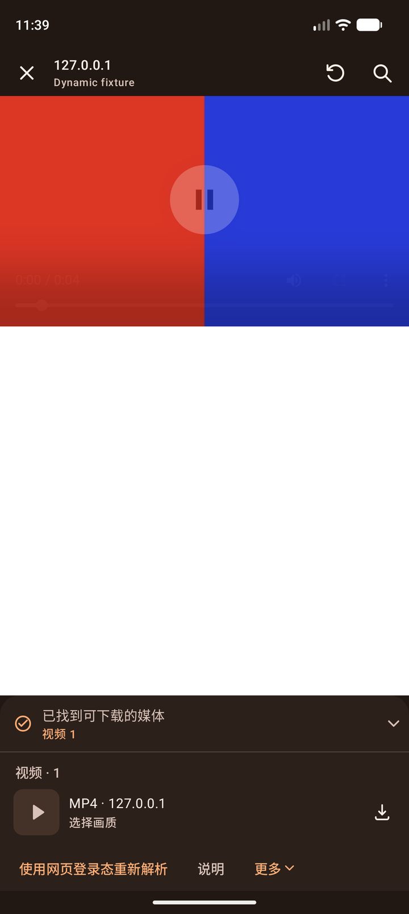
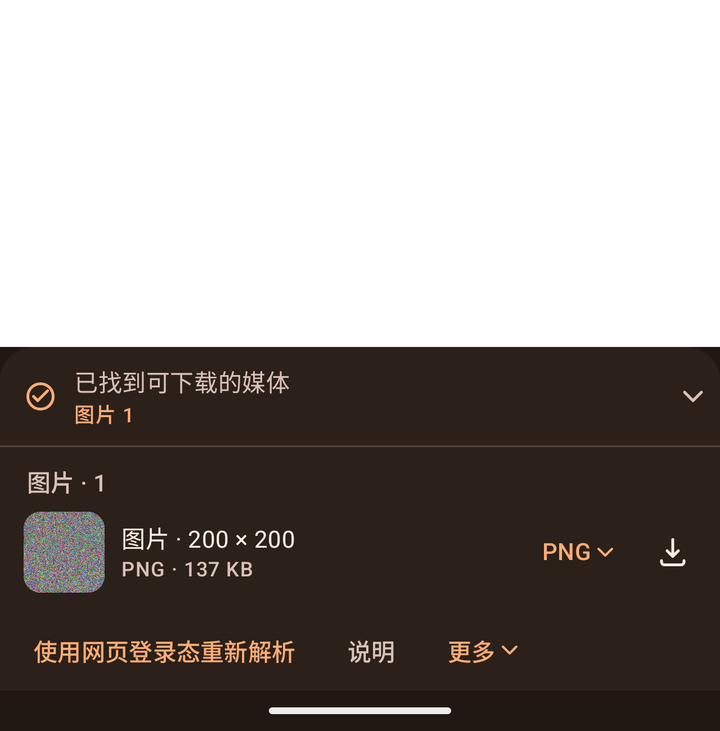
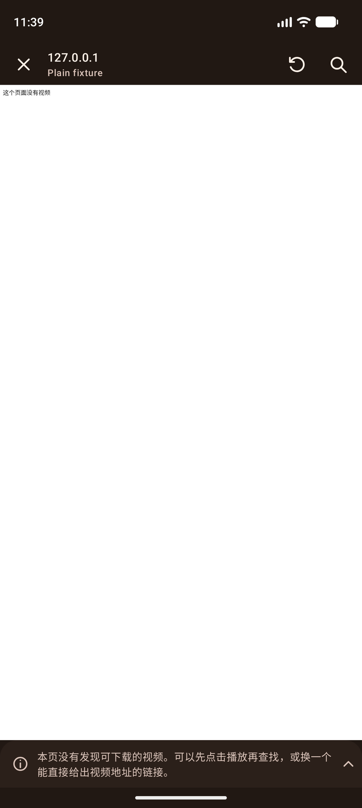
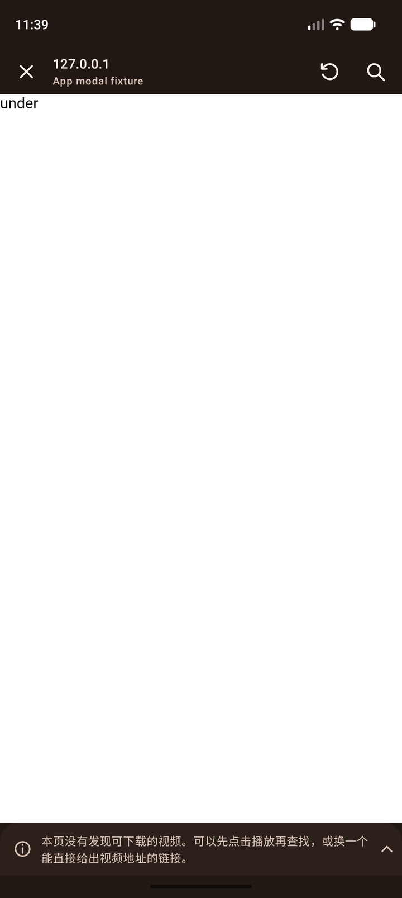
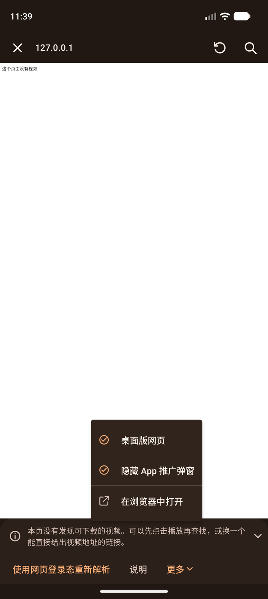
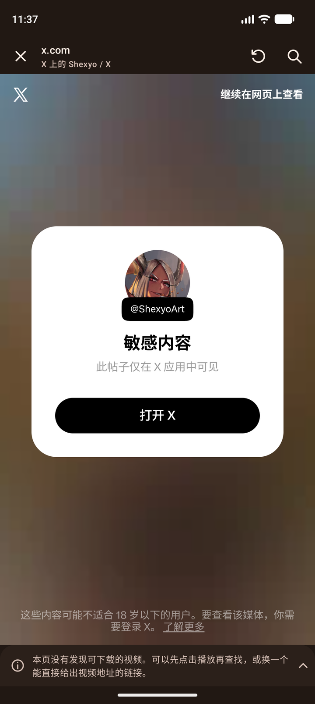

# 网页面板重做与网页适配验证（2026-11-18）

> 关联：[README 的「通用网址与网页辅助」](../../README.md#通用网址与网页辅助) ｜ [X 失败归因验证](x-post-recovery-2026-11-18.md) ｜ [TODO](../TODO.md)
>
> 本轮目标：截图里那个「底部四行 Image · PNG/WEBP/JPG/JPG + 一大段 blob/DRM 说明」的网页面板重做——
> 面板收起/自动展开、同一媒体的多格式候选合并、已知平台页走原生解析、网页自己的「打开 App」弹窗与
> 遮挡内容的处理，并保留既有的「扫完必给结论」约束。

## 1. 结论

- 面板改为**收起一行结论 + 按需展开**；扫到候选自动展开一次，用户手动收起后本页不再打扰。
- 候选按「同一份媒体」聚合：X 这类为一张图给多个格式/尺寸 URL 的页面，从四行变成**一行**（缩略图 +
  `图片 · 1300 × 1300` + `PNG · 245 KB` + 行内格式菜单）；视频仍按完整地址单列。
- 页面级「重新解析」对已知平台走 `MultiPlatformVideoRepository`（复用本机网页登录态），普通网页才用
  带 `Referer`/`User-Agent` 的网页会话引擎；原生失败且不是「需要登录」时回退一次网页会话引擎。
- 网页自己的「打开 App」推广弹窗按已知文案隐藏；另提供「桌面版网页」「在浏览器中打开」两个出口，
  以及「隐藏 App 推广弹窗」开关。**不碰登录墙**：真实链接里 X 的「敏感内容」登录门禁没有被隐藏。
- 头像/资料横幅/表情按 URL 路径判为装饰图：线上实测 X 门禁页的作者头像（400×400）不再被当成
  「已找到可下载的媒体」。
- JVM **686** 例通过（新增聚合 10 例、面板状态 8 例、图片装饰图 1 例）；设备 `BrowserAssistDeviceTest`
  **6/6** 通过。
- **未覆盖**：真实的 X「See this post in the app」弹窗没有在本次模拟器会话里复现（本次出现的是
  「敏感内容」登录门禁，**故意不隐藏**），弹窗隐藏只在 fixture 页面上验证；桌面版 UA 在真实站点的
  版式、缩略图在防盗链 CDN 上的失败回落、平板/折叠屏均未验证（见第 5 节）。

## 2. 环境

| 项 | 值 |
| :--- | :--- |
| 主机 | macOS，JDK 用 Android Studio JBR（`openjdk 25.0.3`），Gradle 9.7.1，AGP 9.4.1 |
| 设备 | AVD `Pixel_10_Pro`，Android 17 / API 37，arm64；debug 包（`com.videodown.douyin.debug`） |
| 语言 | 设备系统 en-US；`LocaleTestRunner` 把**被测应用**固定为 zh-CN，断言中文文案 |
| 安装 | 覆盖安装（`leaveApksInstalledAfterRun=true`），全程没有卸载、没有清除应用数据 |
| 网络 | 设备用例全部离线；第 4.4 节真实链接使用模拟器网络 |

## 3. 改动

主代码（`app/src/main/java/com/videodown/douyin/`）：

- `data/generic/MediaCandidates.kt`（新增）：`CandidateGroup` + `groupCandidates`。身份 = 主机 + 去扩展名
  路径 + 过滤掉 `format`/`name`/`w`/`h` 等纯格式参数后的 query；视频按完整 URL 单列；代表项按面积、
  格式质量（PNG > WebP > JPEG）、字节数排序；缩略图取已知最小字节数的变体。
- `data/generic/ImageMedia.kt`：新增 `isNoiseUrl`，按路径段过滤 `profile_images`、`avatar(s)`、`emoji`、
  `bfs/face` 等装饰图目录（只按路径，`?avatar=1` 不算）。
- `data/generic/BrowserMediaDetector.kt`：候选探测时同时应用尺寸/字节噪音与装饰图过滤。
- `presentation/browser/BrowserStatus.kt`：`browserStatusRes` 换成可测的 `BrowserPanelStatus` 状态机
  （Message / Loading / Hint / Scanning / Found / ChannelsOnly / Empty），显式消息永远优先。
- `presentation/browser/BrowserPanel.kt`（新增）：收起态一行结论 + 计数；展开态分组候选、缩略图、
  格式下拉、操作行（重新解析 / 说明 / 更多）；「更多」里是桌面版网页、隐藏 App 推广弹窗、在浏览器中打开。
- `presentation/browser/PageTweaks.kt`（新增）：桌面版 UA 常量与「App 推广弹窗」隐藏脚本
  （只处理文案命中的 `role=dialog` / `aria-modal` / `data-testid=sheetDialog`，并解除滚动锁）。
- `presentation/browser/BrowserAssistScreen.kt`：顶部栏改为「关闭 + 主机名/页面标题 + 后退(可后退时) +
  刷新 + 查找」，加载进度条；WebView 增加 `WebChromeClient`（标题/进度）、宽视口；面板接入；
  平台分流解析；扫描 12 秒看门狗；返回键先收面板、再后退、最后关闭。
- `res/values/strings.xml`、`res/values-en/strings.xml`：新增 24 条中英成对文案，删除已不用的
  `browser_candidate` / `browser_candidate_image`。

测试与文档：`MediaCandidateGroupingTest`（新增 10 例）、`BrowserStatusTest`（重写 8 例）、
`ImageMediaTest`（+1 例）、`BrowserAssistDeviceTest`（更新 2 例、新增 4 例）、`FixtureServer`（+2 个页面）、
`README.md`、`docs/TODO.md`。

## 4. 验证

### 4.1 JVM

```bash
export JAVA_HOME="/Applications/Android Studio.app/Contents/jbr/Contents/Home"
./gradlew testDebugUnitTest
# BUILD SUCCESSFUL — 110 个测试类 / 686 例，0 失败、0 跳过
```

分项：`MediaCandidateGroupingTest` 10、`BrowserStatusTest` 8、`ImageMediaTest` 5（含新增装饰图 1 例）、
`LocalizationGuardTest` 4（中英 key 完全对齐，中文文案预算仍为 0）。

### 4.2 设备

```bash
./gradlew connectedDebugAndroidTest \
  -Pandroid.testInstrumentationRunnerArguments.class=com.videodown.douyin.BrowserAssistDeviceTest
# BUILD SUCCESSFUL — 6/6 通过
```

| 用例 | 覆盖 | 耗时 |
| :--- | :--- | ---: |
| `dynamicPageRequiresPlayThenDetectSelectAndDownload` | 播放后探测到 MP4 → 点候选 → 解析 → 下载 → 从「查看已保存内容」进入播放器 | 8.19 s |
| `aPageWithoutMediaExplainsItselfInsteadOfStayingSilent` | 空页面给结论；展开后重新解析失败时状态行不留白 | 3.79 s |
| `oneImageWithSeveralFormatUrlsIsListedOnce` | 三个 URL（PNG / JPG / 带格式参数的 JPG）+ 一个头像 → 只有一行，格式菜单有另一份编码 | 1.50 s |
| `pageOwnAppPromptDialogIsHidden` | 文案命中的 `role=dialog` 被隐藏，页面内容 `under` 仍在 | 1.11 s |
| `desktopSiteTogglesUserAgent` | 切桌面 UA、页面真的重载（`performance.timeOrigin` 变化）、再切回系统 UA | 3.20 s |
| `topBarShowsPageTitle` | 顶部栏显示网页标题 `Plain fixture` | 0.90 s |

说明：动态页面用例原先点的是结果页里并不存在的「播放」控件（任务卡才有），属于**既有失效断言**；
本轮改为等下载完成后点结果页主按钮「查看已保存内容」，并且等「已加入 N 个下载任务」的 Snackbar
消失后再点，避免触摸被它吃掉。测试意图（探测 → 选择 → 下载 → 播放）不变。

### 4.3 截图

| 图 | 说明 |
| :--- | :--- |
|  | 面板展开、视频候选一行；操作行是「重新解析 / 说明 / 更多」 |
|  | 三个图片 URL + 一个头像 → 一行、缩略图、`PNG · 137 KB`、格式菜单 |
|  | 收起态的一行结论（无媒体） |
|  | fixture 上「See this post in the app」被隐藏，页面内容仍在 |
|  | 「更多」菜单：桌面版网页 / 隐藏 App 推广弹窗均带勾选 |
|  | 真实 X 链接：标题正常、头像被过滤、登录门禁**不隐藏**、面板如实说没找到 |

### 4.4 真实 X 链接（模拟器网络，手动）

步骤：`adb shell am start -a android.intent.action.VIEW -d "https://x.com/ShexyoArt/status/2122404334675665059"` →
等原生解析给出「需要登录或验证」→ 点「打开网页查找视频」。

观察：

1. 顶部栏显示 `x.com` + 页面标题「X 上的 Shexyo / X」，说明 `onReceivedTitle` 生效。
2. 页面弹出的是 X 的「敏感内容 / 此帖子仅在 X 应用中可见 / 打开 X」**登录门禁**，不是推广弹窗；
   按设计不隐藏，也不尝试绕过。页面下方的官方说明写着「要查看该媒体，你需要登录 X」。
3. 门禁页只加载了作者头像（`pbs.twimg.com/profile_images/...`，400×400）。**头像被装饰图过滤掉**，
   面板显示「本页没有发现可下载的视频…」，不再把头像报成媒体（对比：加过滤前同一页面曾列出
   `图片 · 400 × 400 · JPG · 29 KB`）。

## 5. 未覆盖边界

- **真实的 X「See this post in the app」弹窗未复现**：本次模拟器会话里 X 给的是敏感内容登录门禁；
  弹窗隐藏在 fixture 上验证通过。若真实站点把弹窗换成非 `role=dialog` 的结构或改文案，脚本会静默失效
  （此时用桌面版网页兜底），这属于已写入 README 的「尽力而为」边界。
- **桌面版 UA 没有在真实站点逐站验证**：设备用例只断言 UA 真的换了、页面真的重载；版式、登录态与
  媒体是否可播取决于站点。
- **缩略图只在本地 fixture 与真实 X 头像/图片上看到成功**：防盗链 CDN 返回 403 时的占位回落没有专门
  用例，只做了代码层兜底。
- **未验证平板/折叠屏/横屏**：面板高度按屏幕高比例计算，但没有设备矩阵覆盖。
- **真实账号登录后的原生 X 解析**：与本轮无关的既有边界，见 [X 失败归因验证](x-post-recovery-2026-11-18.md)。

## 6. 与计划的差异

- 额外把「头像/资料横幅/表情」按 URL 路径判为装饰图：真实链接验证时发现 X 门禁页会加载 400×400 头像，
  面板把它当成了可下载媒体；不处理就会和截图里的噪音同类。
- 操作行从「重新解析 / 说明 / 桌面版网页 / 隐藏弹窗 / 在浏览器中打开」五个平铺项收成
  「重新解析 / 说明 / 更多」，避免小屏上被切成半截（首版实测截断在「隐藏 Ap…」）。
- 动态页面设备用例的陈旧断言一并修正（见 4.2 说明），这是本轮改动的测试前置条件，不是新增产品行为。
