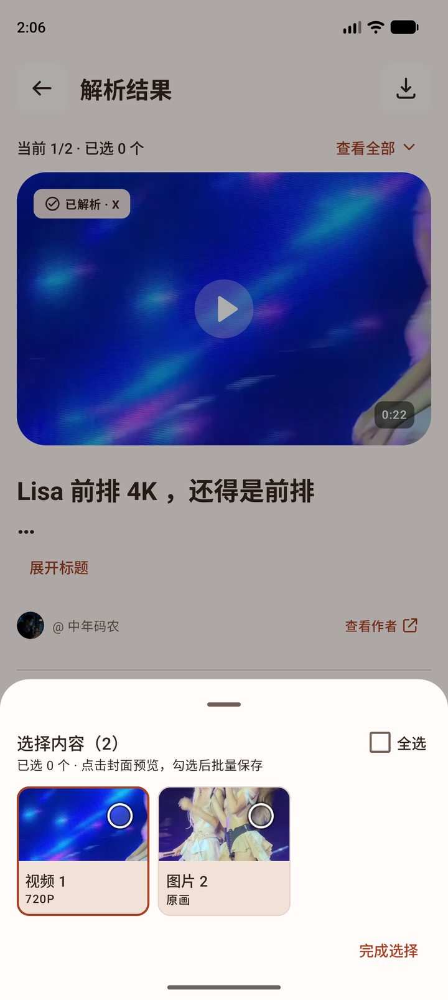
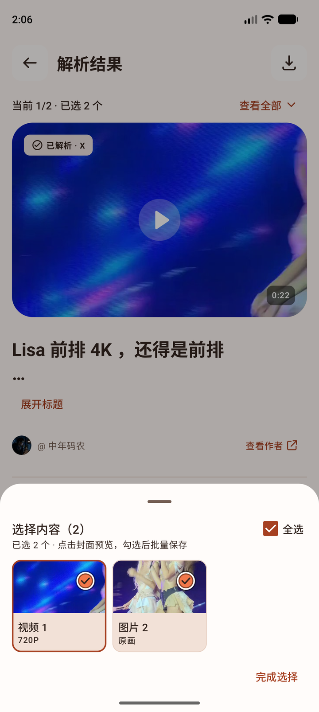
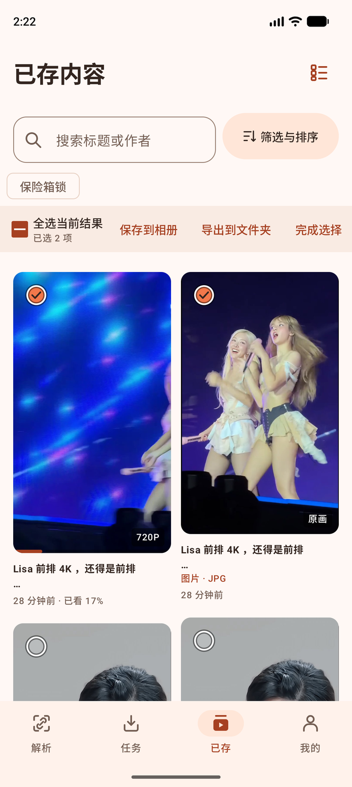

# 封面选择标记统一（2026-11-20）

## 结论

解析结果「选择内容」面板的勾选标记，原来是「48dp 浅色圆盘 + 里层 20dp 空方框」，现在与「已存」
页一致：**24dp 手绘圆环 / 橙色对勾，48dp 命中区，4dp 内缩**。两处共用新组件
`presentation/components/CoverSelectionMark.kt`；全 App 排查后没有第三处同类「封面浮层控件」。

| | 改造前 | 改造后 |
| :--- | :--- | :--- |
| 可见标记 | 48dp `surface` 90% 圆盘 + 20dp 空勾选框 | 24dp 圆环；选中为品牌橙填充 + 深色对勾 |
| 缩略图占宽 | 48dp / 126dp ≈ 38% | 24dp / 126dp ≈ 19% |
| 命中区 | 48dp | 48dp（不变） |

## 现象与原因

- 结果选择面板每个缩略图（`GridCells.Adaptive(100.dp)`，实测 126dp 宽）右上角一块白色大圆盘贴角，
  占缩略图 38%，里面只有一枚 20dp 的空方框（`before.png`）。
- 根因在 `HomeScreen.kt`：`Checkbox` 自带 **48dp 最小触控区**，代码又把
  `background(surface.copy(alpha=.9f), CircleShape)` 挂在 Checkbox 上——于是「触控区」被画成了
  「可见底形」。这与上一轮「更多」按钮（48dp 深色圆 + 18dp 图标）是同一种病：**大底色 + 小图形 + 贴角**。
- 仓库里已有正确画法：「已存」页的 24dp 手绘圆环（白细环 + 黑 45% 外描边；选中品牌橙 + 深色对勾），
  但它以内联 `Canvas` 实现，没有复用。

## 全 App 排查

| 位置 | 现状 | 处理 |
| :--- | :--- | :--- |
| 结果选择面板缩略图（`HomeScreen.kt`） | 48dp 浅色圆盘 + 20dp 空 Checkbox，贴角 | **本轮改为统一圆环** |
| 已存网格/列表封面选择圈（`LibraryScreen.kt`） | 内联 Canvas 24dp 圆环 + 48dp 命中 | **抽成共享组件**，视觉不变（内缩 2dp → 4dp） |
| 已存封面「更多」（`LibraryScreen.kt`） | 上一轮已改为 32dp 主题色圆 + 18dp 图标 | 保持 |
| 任务页勾选（`HistoryScreen.kt`） | 行内 Material Checkbox，不在封面上 | 不改 |
| 批量导入行勾选（`BatchImportDialog.kt`）/ 全选（`SelectAllToggle`） | 行内 / 工具栏三态勾选 | 不改 |
| 结果页封面主播放键（`HomeScreen.kt`） | 56dp 白 28% + 35dp 图标，比例正常 | 不改 |
| 看图器 / 播放器浮层按钮 | 沉浸式黑白遮罩 | `BrandColors` 约定中的媒体可读性例外，不改 |
| 站点观看卡、历史缩略图 | 封面无浮层控件（删除键在行尾） | 无 |

## 实现范围

- `presentation/components/CoverSelectionMark.kt`（新增）：
  - 外层 48dp `Box`：`clip(CircleShape)` + `toggleable(role = Role.Checkbox)` +
    `semantics { contentDescription = 调用方文案 }`。命中区、勾选语义、朗读与改前一致。
  - 内层 24dp `Canvas`：未选 = 白色 2dp 环 + 黑色 45% 外描边（浅色封面上不消失）；
    选中 = `BrandColors.selectionIndicator` 填充 + `onSelectionIndicator` 对勾；`enabled == false` 时
    `alpha(.38f)`。
  - 位置由调用方 `align + padding` 决定（与 `CoverChip` 的分工一致）。
- `LibraryScreen.kt`：删除内联 `Box + Canvas` 选择圈，改用组件；内缩统一为 `AppSpacing.xxs`（4dp）；
  清理因此不再使用的 8 个 import（`Canvas / Offset / StrokeCap / Stroke / toggleable / alpha /
  CircleShape / BrandColors`）。
- `HomeScreen.kt`：选择面板的 `Checkbox + 圆形背景` 换成组件（`TopEnd` + 4dp），
  `home_check_label` 文案与禁用条件原样传给组件。
- 文案、`video-selection-grid` tag、卡片 `selected` 语义、预览点击、批量保存逻辑均未改动。

## 实测

- 选择标记命中区：`144 × 144 px`（48dp，density 3）；可见圆环：`72 px`（24dp）。
- 选中对勾 `#33251F` on `#F2784B` ≈ **5.3:1**；圆环沿用已存页既有画法（白细环 + 黑 45% 外描边），
  在深色与浅色封面上都可见（见 `dark.png`）。

## 自动化证据

| 项目 | 结果 |
| :--- | :--- |
| `ResultSelectionDeviceTest` | **5/5**（新增 1 例：命中区 ≥48dp、点选/取消、已选计数；原有批量保存、预览不变、全选三态用例通过） |
| `LibraryActionsDeviceTest` | **6/6** |
| `LibraryKindFilterDeviceTest` | **1/1** |
| `./gradlew testDebugUnitTest` | **744 例通过**（本轮无 JVM 可测逻辑，全量确认无回归） |
| `lintDebug` | 本改动文件 0 error；仓库仍有 12 个既有 error（`ArchivePublisher` / `BrowserAssistScreen` / `OnlinePlayerScreen` / `SiteHubScreen`），未处理 |

新用例第一版曾失败：`已选 1 个` 同时出现在弹层提示与页面头部（「当前 1/12 · 已选 1 个」），
单节点断言命中 2 个节点；改为断言弹层的完整提示文案后通过。

### 截图

改造前（旧包实测）：

改造后（未选 / 已选）：

深色主题，与已存页网格多选态：

## 未覆盖边界

1. **禁用态**（提交中 / 有重复任务 / 无画质可选）：只由组件 `alpha(.38f)` 与传入的 `enabled` 覆盖，
   没有单独截图。
2. **平板 / 折叠屏 / 横屏**：未截图；标记不参与布局，只改浮层视觉。
3. **行内 Material Checkbox**（任务页、批量导入、全选）有意保持 Material 样式，未与圆环统一。
4. 仅在 Android 17 / API 37 模拟器（Pixel_10_Pro，arm64）验证，未在真实设备复跑。
