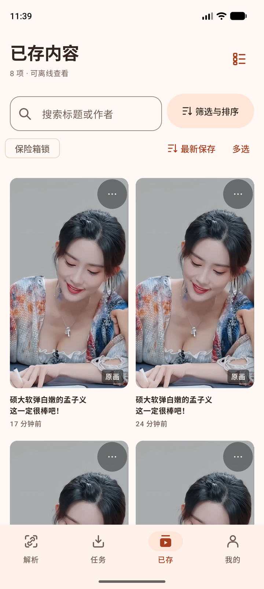
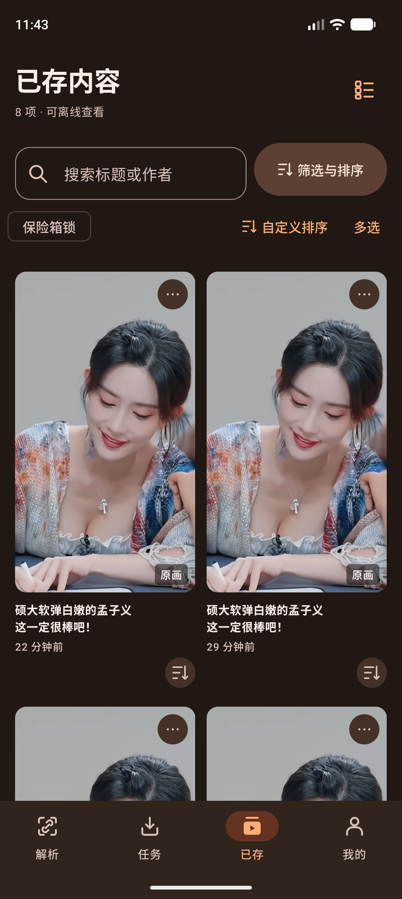
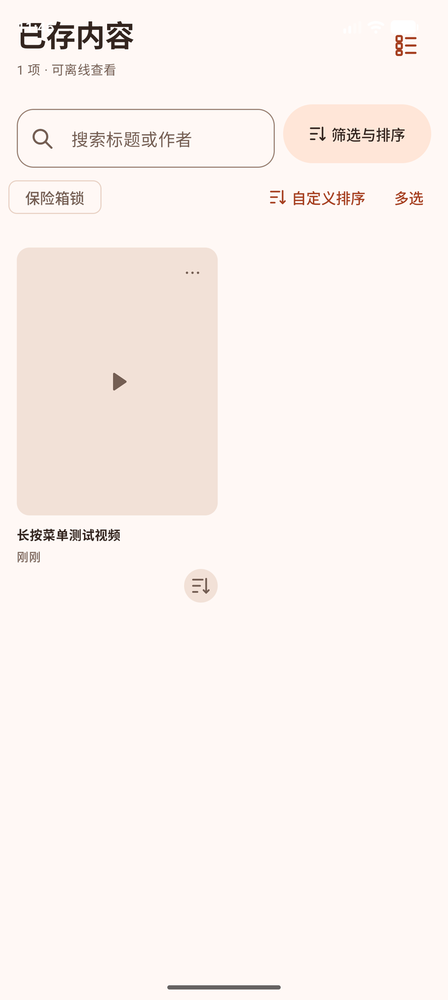
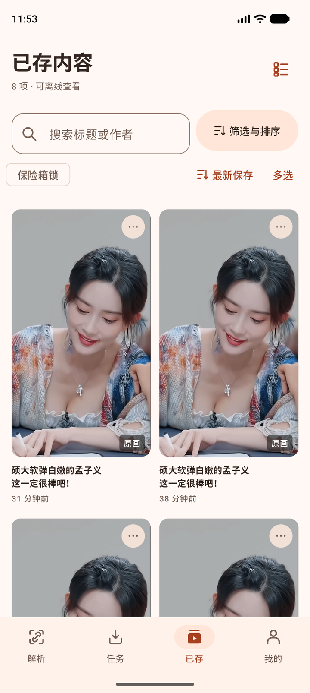

# 已存内容卡片「更多」按钮视觉收敛（2026-11-20）

## 结论

网格卡片封面右上角的「更多」从「48dp 黑 38% 实心圆 + 18dp 白点、贴角 2dp」改成
「32dp 主题色圆底 + 18dp `onSurfaceVariant` 三点、视觉内缩 8dp」；48dp 命中区、ripple、
按钮语义与 `library-more-<id>` 测试 tag 全部保持。网格卡片下方原本独立的拖拽手柄圆底
改为与新按钮共用同一个组件，两个角上的控件不再一深一浅。

## 现象（改造前）

每张卡片右上角是一块 48dp 的深灰实心圆，直径接近「原画」角标的两倍，圆内只有 18dp 的白点
（比例 2.67:1），且只内缩 2dp、压住封面 12dp 圆角。在浅色照片上像一块灰色贴纸，而不是控件。

## 设计依据

- **尺寸/比例**：可见圆 32dp、图标 18dp（1.78:1），此前 48dp / 18dp（2.67:1）；图标本身不缩小，
  只收底形，视觉重量明显下降。
- **内缩**：48dp 命中框贴住封面右上角，32dp 圆在其中居中 → 视觉距两条边各 8dp（此前 2dp），
  不再压住 `shapes.medium` 的圆角。
- **配色**：改用 `MaterialTheme.colorScheme.surfaceContainerHighest` 底 +
  `onSurfaceVariant` 图标。`BrandColors` 的 KDoc 明确写「播放器/看图器为媒体可读性使用的黑白遮罩
  属于明确例外」，普通卡片上的控件应走主题色——此前这里是全应用唯一在普通卡片上使用黑底遮罩的控件。
- **对比度**（按主题 token 计算，非照片采样）：浅色 `#745E53` on `#F2E1D7` ≈ **4.7:1**；
  深色 `#D8C2B8` on `#443229` ≈ **7.1:1**。圆底不透明，因此对比度与封面照片无关；此前白色图标
  叠在照片上是随照片明暗变化的。
- **复用**：`AGENTS.md` 要求同一视觉结构出现在第二处时收敛到 `presentation/components/`。
  改完后「更多」与拖拽手柄就是同一结构，因此抽出 `CoverChip` 共同使用。

## 实现

| 文件 | 改动 |
| :--- | :--- |
| `presentation/components/CoverChip.kt`（新增） | 32dp `CircleShape` + `surfaceContainerHighest` 圆底，只负责可见底形；命中区由调用方负责 |
| `presentation/library/LibraryScreen.kt` | 网格 `onMore` 改为 `IconButton(48dp) { CoverChip { AppIcon(More, 18dp, onSurfaceVariant) } }`；网格拖拽手柄改用 `CoverChip`，保留 `draggableHandle()`、自定义无障碍动作与 `library-drag-<id>` tag |

不改：列表布局的行内「更多」（本来就是裸图标）、任务页 `task-more`、封面「原画」角标、
`MediaCover` 默认行为。

## 视觉与尺寸实测

- 设备实测（Pixel_10_Pro / API 37，density 3）：可点节点 **144×144 px = 48dp**；图标节点
  **54×54 px = 18dp**；沿圆底中心线采样圆的横向跨度 **96 px = 32dp**。

| 深色主题 | 无封面占位 |
| :--- | :--- |
|  |  |

## 自动化证据

- `LibraryActionsDeviceTest` **6/6**（新增 `cardOverflowKeepsTheFullTouchTarget`：断言
  `library-more-<id>` 的宽高均 ≥48dp，并用同一张无封面卡片留证
  `waterfall-overflow.png`；原有「更多」打开同一菜单的用例继续通过）。
- `LibraryReorderDeviceTest` **4/4**（拖拽手柄 tag 与拖拽行为未变）。
- `AdaptiveLayoutDeviceTest` **5/5**（瀑布流/列表切换与自适应内容未受影响）。
- JVM：`./gradlew testDebugUnitTest --rerun-tasks` **742 例通过**。本轮没有新增可纯 JVM 覆盖的逻辑，
  只跑了全量回归；一次复跑中出现 `QueueReorderTest` 的既有偶发失败（`docs/TODO.md` 已记录该 flake），
  单独复跑与随后 `--rerun-tasks` 全量复跑均通过。
- `./gradlew lintDebug`：本改动文件无新增 error（工作区仍有 12 个与本改动无关的既有 error）。

改造后：

## 未覆盖边界

1. **无封面占位**：`MediaCover` 的占位底色恰好也是 `surfaceContainerHighest`，此时圆底与背景同色，
   只剩三点可见（见上表右图）。这与列表布局的裸图标一致，是刻意取舍；没有额外加描边。
2. **动态取色（Material You）**：只验证了默认暖色主题与系统深色主题；Pixel 动态色板下
   `surfaceContainerHighest` 的具体取值未逐一切换截图。
3. **平板/折叠屏与大字号**：只跑 Compact 手机；`AdaptiveLayoutDeviceTest` 覆盖布局切换，但本轮
   没有专门在大屏上截图确认 32dp 圆底的视觉比例。
4. **TalkBack**：`contentDescription`、`Role.Button` 与点击行为未变，但未逐项朗读验证；
   命中区由设备用例断言。
5. **无 JVM 测试**：本次只改 Compose 视觉与命中区，没有可纯 JVM 覆盖的逻辑；没有用相邻用例替代。
