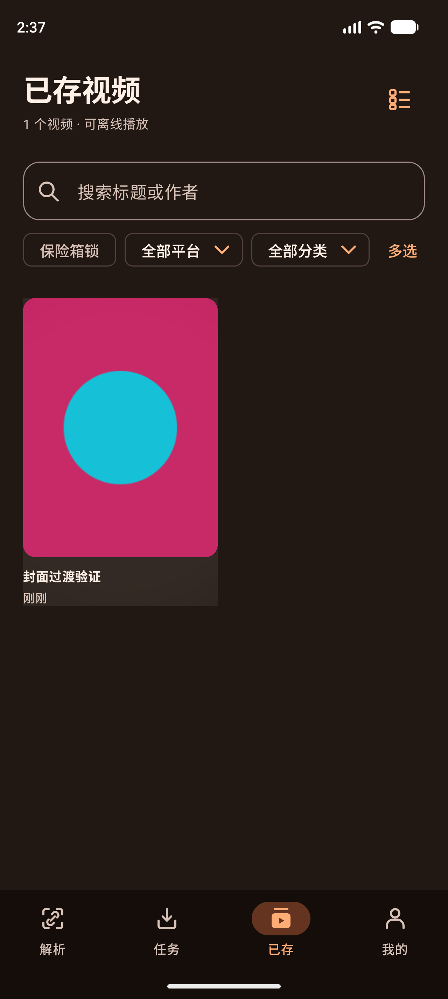
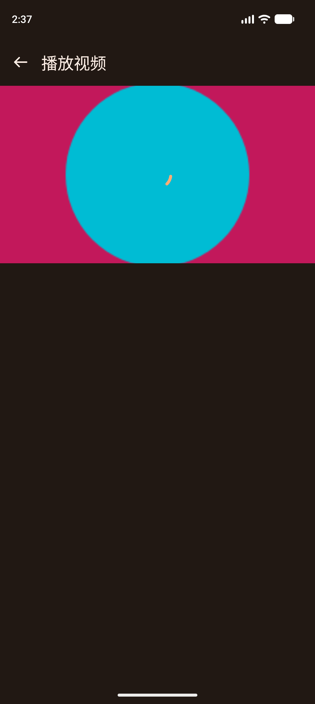
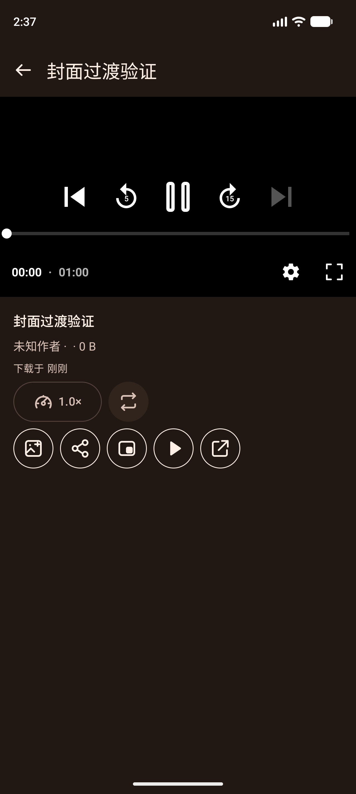
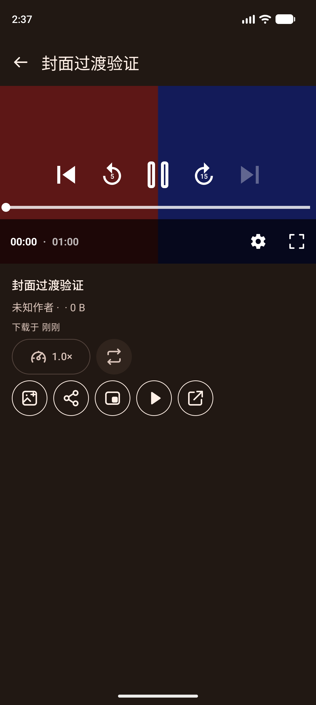
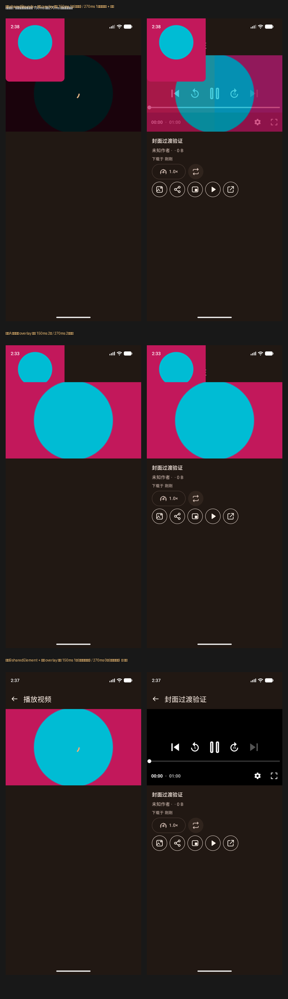

# 动效批次 2：已存封面 → 播放器共享元素（2026-10-12）

选型与批次划分见计划《拾影 · 动画选型与落地计划》。本批实现「已存封面 → 播放器封面」的共享元素过渡，
并在过程中发现三件必须记录的事实。

## 一、实现

| 文件 | 改动 |
| :--- | :--- |
| `presentation/components/SharedCover.kt`（新增） | `playerCoverKey(recordId)`；`Modifier.sharedCover(...)`：作用域为 null 时原样返回，源侧可选画在共享层最上面（`renderInSharedTransitionOverlay`） |
| `MainActivity.kt` | `NavHost` 外包一层 `SharedTransitionLayout`，逐屏把 `SharedTransitionScope` / `AnimatedVisibilityScope` 传下去；新增 `openPlayer(id)`：**从内存里的 `historyState` 取封面**（列表数据本来就在内存，不额外读库）并写入路由 |
| `MainActivity.kt` | 播放器路由由 `player/{recordId}` 变为 `player/{recordId}?cover={cover}`（`Uri.encode`，缺省空串） |
| `LibraryScreen.kt` | 网格与列表两处封面挂 `sharedCover(..., clipInOverlay = true)`（作为共享元素的**源**） |
| `PlayerScreen.kt` | 新增 `coverUrl` 与两个可空作用域参数；视频区最底层加封面海报（共享元素的**目标**），带 `testTag("player-cover-poster")` |

## 二、三件必须记录的事实

### 1. 共享元素的目标不可能在第一帧出现——除非封面随路由带过去

播放器的 record 是**异步**读库得到的：`PlayerViewModel.load()` 起协程，`DownloadHistoryRepositoryImpl.getById()`
里 `store.load()` 有 `withContext` 文件读，**首次必然挂起**（之后也要跨线程一跳）。而共享元素的源与目标
必须在同一帧就位，否则不会有配对动画。

所以封面不能等 record：导航时把 `coverUrl` 写进路由，播放器直接用它渲染海报。封面来自
`historyState.records`（`HistoryViewModel` 的 StateFlow，界面本来就在用），是同步内存查找，不增加一次读库。

### 2. 海报只在 `loading` 期间显示会太短——要留到视频真正出画

`loading` 在 record 到位的那一刻就结束了（几毫秒～几帧），而共享元素动画约 300 ms——照 `loading` 收海报
会在动画中途把它抽走。改为监听 `Player.Listener.onRenderedFirstFrame()`：海报留到视频画出第一帧为止；
纯音频（永远没有视频帧）与无封面条目不显示海报。

### 3. `pipScreenOffThenReturnKeepsActivityAndPlayer` 在动画缩放为 0 时通过

`docs/TODO.md` 里这条一直记为「API 37 模拟器限制」。本批把三项动画缩放设为 0 后（Espresso 本来就要求关闭动画），
`P3PictureInPictureDeviceTest` **4/4 通过**，包括这一条。即它是**动画时序敏感**，不是环境能力缺失。
该 TODO 条目已按此更新。

## 三、安全设计（为什么老用例不受影响）

- 两个作用域参数**可空且默认 null**：所有直接渲染单屏的设备用例（`LibraryActionsDeviceTest`、
  `P2AudioUiDeviceTest`、`P3PlaybackDeviceTest` 等 9 处）不传作用域，封面不带共享修饰，行为与改造前一致。
- 全屏与 PiP 下不参与共享（`!fullscreen && !inPip`）——那时容器尺寸与窗口都变了，不应再做形变。
- 共享元素只接在「已存 → 播放器」这条路径上（源侧只在已存封面）。任务页/首页进入播放器同样会带封面，
  但源侧没有共享元素：只会看到一张加载海报，没有形变（属可接受的行为变化，已记录）。

## 四、验证

```bash
./gradlew :app:testDebugUnitTest        # 397 项通过
./gradlew :app:assembleDebug            # 成功
./gradlew :app:connectedDebugAndroidTest -Pandroid.injected.androidTest.leaveApksInstalledAfterRun=true \
  -Pandroid.testInstrumentationRunnerArguments.class=<类名>   # 三项动画缩放需为 0
```

设备（Pixel_10_Pro AVD / API 37），本批共 **48 条用例通过**：

- 新增 `PlayerCoverPosterDeviceTest` 2 条：有封面且视频未出画时海报**持续存在**（等 600 ms 后仍在，
  证明不是一闪而过）；纯音频不出海报。
- 新增 `PlayerCoverTransitionDeviceTest` 1 条：夹具 + 时钟受控取帧（见第五节），并断言过渡结束后已离开「已存」。
- 播放器与布局：`P3PlaybackDeviceTest` 7、`PlayerLandscapeDeviceTest` 4、`P3PictureInPictureDeviceTest` 4、
  `PlayerGestureDeviceTest` 1、`SubtitleDownloadDeviceTest` 2、`SleepTimerDeviceTest` 2、`P2AudioUiDeviceTest` 4。
- 列表与导航：`LibraryActionsDeviceTest` 4、`BatchFeaturesDeviceTest` 7、`Material3NavigationDeviceTest` 3、
  `P2LibraryOrganizationDeviceTest` 3、`P2BatchImportDeviceTest` 4。

## 五、形变已被看到：夹具 + 时钟受控取帧

「过渡好不好看」原本是本批最大的缺口（模拟器上没有带封面的已存视频、本机也无法解码录像）。
补了一条 `PlayerCoverTransitionDeviceTest` 把这件事变成可复现的证据：

- 夹具是真的：运行时画一张洋红底 + 青圆的封面图（`file://` 交给 Coil）、复制真实的
  `landscape-fixture.mp4`、写进真实 history store——走的是与用户完全相同的「已存 → 播放器」路径，用例结束清理。
- 取帧靠 Compose 测试时钟：`mainClock.autoAdvance = false` 之后点击条目，再 `advanceTimeBy`
  到 60 / 150 / 270 ms 各截一张，最后恢复自动推进并断言已经离开「已存」。
- 断言里**不能用 `targetContext.getString(...)` 拼期望文案**：`targetContext` 的资源按系统语言（en-US）取，
  而界面按应用语言渲染中文，会拿到一串英文。改用字面量。

证据（定稿实现 = 变体B `sharedElement`，夹具为洋红底 + 青圆；下面 5 张就是这条路径的真实帧）：

-  点击前：已存只有这一个条目。
-  60 ms：仍在已存页，条目下方出现共享层阴影带（源侧已进共享层）。
-  150 ms：封面**已长到视频框大小**，播放器标题与返回键完好可见。
-  270 ms：封面已交棒给视频（不再有拷贝），播放器控件与元数据就位。
-  过渡结束：视频正常播放。

### 三种实现的三角对照（同一夹具、同一取帧时刻）

按你的要求把「两侧都进 overlay」和 `sharedElement` 都各做了一轮，与基线一起比。判定方法刻意不靠肉眼：
夹具封面是洋红底 + 青色圆，**每个封面拷贝恰好有一个青色圆**，用连通域数圆的个数即可客观数出
「同一时刻同屏画了几份封面」（早先用洋红面积统计是错的——圆心会把洋红切成两块，看起来像两份）。

| 点击后 | 基线 `sharedBounds` + 源侧 overlay | 变体A 两侧都进 overlay | 变体B `sharedElement` + 源侧 overlay |
| :--- | :--- | :--- | :--- |
| 60 ms | 1 份（在网格里） | 1 份 | 1 份 |
| 150 ms | 1 份，仍停在左上小尺寸 | **2 份**（视频区 + 左上各一份） | **1 份，已长到视频框** |
| 270 ms | 1 份仍钉在左上 + 视频区半透明残影 | **2 份原样冻住** | **0 份**（已交棒给视频） |



结论：**采用变体B `sharedElement` + 只给源侧进 overlay**。它是唯一单调收敛的一种（网格 → 视频框 → 交棒给视频），
而且过渡全程不遮挡播放器头部与控件（150 ms 帧里「播放视频」标题完好）。已按此定稿：
`SharedCover.kt` 用 `sharedElement`，源侧 `renderInSharedTransitionScopeOverlay`，目标侧不进 overlay。

### 一处必须更正的旧结论

上一轮我写过「150 ms 处源侧与目标侧同时可见，封面被画了两遍」。**那个判断是错的**，原因不是代码而是夹具污染：
设备历史里残留了一条别的测试留下的记录（「张岱樾的微博视频」），它的封面正好是绿色地板，
被我当时的绿色统计算成了"第二份封面"。清理残留 + 换成视频里不会出现的洋红夹具后，
基线在 150 ms 其实只有一份。教训：**取帧验证前先确认夹具是环境里唯一的数据**，
颜色统计也要选一个环境里不可能出现的特征色。

### 其余观察

- 默认 `BoundsTransform` 太慢：第一轮用默认 spring 时 270 ms 处封面仍明显落后，已换成与全应用一致的 250 ms 曲线。
- 过渡期间元数据列还是空的（等 record 异步读库），属原有行为，未改。
- 本用例顺带修了测试自身的卫生问题：夹具清理原先只删自己那条 id，崩溃的上一次运行会留下同名记录；
  现在改为按标题清理，并在 `@Before` 也清一次。

## 六、其余边界

- 未在真机（SHARK PRS-A0 / API 30）复跑；未跑 `live_*` 联网组。
- 共享元素时长已按第五节实测接到批次 0 的 `AppMotion`（250 ms）；若产品判定还需调整，改 `SharedCover.kt` 一处即可。
- 已存列表的封面在**选择态**下同样带共享修饰（未按选择态排除）；选择态不进播放器，实际不会触发。
