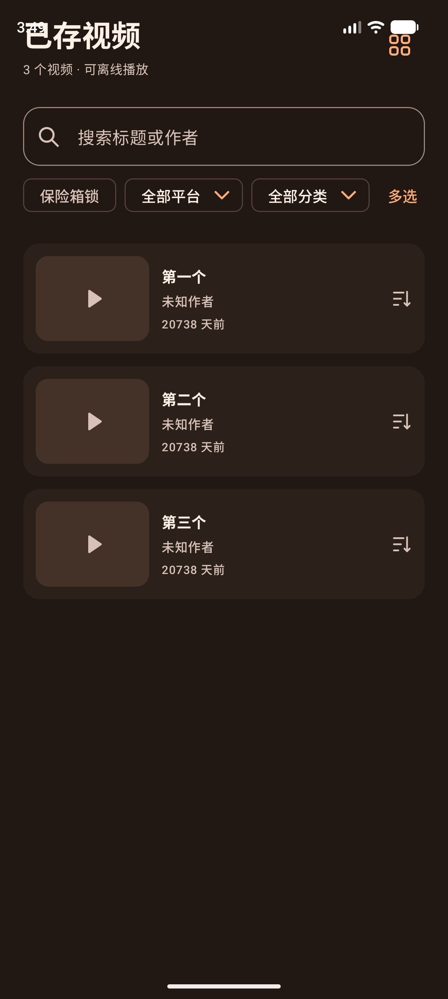

# 批次 3：拖拽排序 + 顺序持久化（2026-10-12）

选型与批次划分见计划《拾影 · 动画选型与落地计划》。本批把「拖拽调整顺序」做出来，并让顺序**跨进程存活**。

## 一、动手前核实的现状（决定了工作量）

1. **任务队列顺序其实已经持久化**：`DownloadRecord.queueOrder` 字段 + `DownloadEngine.moveInQueue()` 写回，
   `resumeAll()` / `autoResume()` 重启后就是按它恢复（`compareBy { queueOrder }.thenBy { createdAt }`）。
   任务卡上的「上移/下移/置顶」走的就是这条链路——所以任务侧**不需要新的存储**。
2. 但它只有 **offset 位移** API（`scheduler.move(id, offset)`），拖拽需要「放到第 N 位」→ 补一个 `reorderQueue(orderedIds)`。
3. **已存页完全没有手动顺序**：`LibrarySort` 只有 NEWEST/OLDEST/LARGEST，而且**连排序选择本身都不持久化**（是 UI state）。
   这里才是真正要动领域模型的地方。
4. 历史 JSON 用 `ignoreUnknownKeys = true` + `encodeDefaults = true` → **给记录加带默认值的新字段前后兼容**，不需要迁移脚本。
5. `core/` 不依赖 `presentation/`（分层干净），而 `ThemeMode`、`PreferredQuality` 这些「要持久化的枚举」都在 `core/`。

## 二、按你的四个选择实现

| 你的选择 | 落地 |
| :--- | :--- |
| 已存新增「自定义」排序模式，默认仍是「最新保存」 | 新增 `LibrarySort.CUSTOM`（枚举移入 `core/`，与 `ThemeMode`/`PreferredQuality` 同惯例）；`LibraryQuery.apply` 增加分支 |
| 首次进入自定义排序惰性 seed 一次当前顺序 | 界面侧 `LaunchedEffect` 里做：切到 CUSTOM 且全部 `sortIndex == 0` 时，按**切换前**的排序写一遍 `sortIndex`，切过去的瞬间列表不跳变 |
| 把手只在「自定义排序 + 无搜索/过滤 + 非多选」出现 | `reorderAllowed` 判定 + `canReorder`（再排除多选与批量忙） |
| 任务页只允许在待下载区间内拖 | 把手只给 `statusFor(record) == PENDING` 的卡片；`reorderQueue` 只重排待下载 id |

## 三、实现清单

| 文件 | 改动 |
| :--- | :--- |
| `domain/model/DownloadRecord.kt` | 新增 `sortIndex: Long = 0`（`0` = 没被手动排过） |
| `domain/repository/DownloadHistoryRepository.kt` | 新增 `reorderLibrary(orderedIds)`（默认空实现，既有 fake 不受影响） |
| `domain/repository/Downloader.kt` | 新增 `reorderQueue(orderedPendingIds)` |
| `data/repository/DownloadHistoryRepositoryImpl.kt` | `reorderLibrary` 写 `sortIndex = index + 1`，未知 id 忽略 |
| `data/download/DownloadQueueScheduler.kt` | 新增 `setOrder(ids)`：把这些 id **按给定顺序放回它们原本占据的槽位** |
| `data/download/DownloadEngine.kt` | `reorderQueue` = `setOrder` + 落盘；把 `moveInQueue`/`reorderQueue` 共用的写盘抽成 `persistQueueOrder` |
| `core/LibrarySort.kt`（新增） | 枚举搬家，便于被偏好持久化 |
| `core/AppPreferences.kt` | 新增 `librarySort` 偏好 + 写进备份快照、恢复时应用 |
| `data/backup/SettingsSnapshot.kt`、`core/SettingsChange.kt` | 快照字段 + 清洗 + `LIBRARY_SORT` 变更项 |
| `presentation/history/HistoryViewModel.kt` | 新增 `reorderLibrary` / `reorderQueue` |
| `presentation/library/LibraryScreen.kt` | 进入时套用持久化排序、改动时落盘；seed；两个布局接 `ReorderableItem` + 把手；把手上挂「前移/后移」无障碍动作 |
| `presentation/history/HistoryScreen.kt` | 任务列表接 `ReorderableItem` + 只在待下载卡片上给把手 |
| `gradle/libs.versions.toml`、`app/build.gradle.kts` | 新增 `sh.calvin.reorderable:reorderable:3.1.0`（计划里唯一的新依赖） |
| 文案 | `sort_custom`、`library_drag_handle`、`history_drag_handle`（中英各一份） |



## 四、几个关键设计点

- **子集重排语义**（最容易被忽略的地方）：`setOrder` 只动传入的 id，被搜索/过滤挡掉的待下载任务保持彼此相对位置，
  不会被挤到队尾；引擎再把调度器算出的**完整顺序**整体落盘，避免只写一半导致界面与重启后的顺序不一致。
- **落盘时机**：拖拽过程只改本地顺序（`draggedOrder` / `pendingOrder`），松手（`isAnyItemDragging` 落回 false）才写一次盘。
  Compose 的拖拽会连续触发很多次位置变化，每次落盘会写整个历史文件。
- **`sortIndex == 0` 的含义**：没排过的记录按 `updatedAt` 降序接在排过的之后——所以刚保存的新视频不会插进用户排好的顺序中间。
- **排序方式本身也持久化**：只持久化顺序而不持久化排序方式的话，重启后列表回到「最新保存」，用户会以为自己白排了。
  这是本批唯一一处「顺带改变了既有行为」的地方（此前排序选择每次启动都会重置），已按仓库惯例走 `AppPreferences`，并随设置备份一起走。
- **不注入偏好到 ViewModel 构造函数**：`HistoryViewModel` 有十几处测试构造点，构造函数里读 `ServiceLocator.preferences`
  会让 JVM 测试与隔离的设备测试都去碰全局偏好。改为按仓仓库既有做法（`libraryLayout` 那样）由界面读写偏好。

## 五、验证

```bash
./gradlew :app:testDebugUnitTest :app:assembleDebug          # 406 项 JVM 通过
./gradlew :app:connectedDebugAndroidTest -Pandroid.injected.androidTest.leaveApksInstalledAfterRun=true \
  -Pandroid.testInstrumentationRunnerArguments.class=<类名>   # 设备；三项动画缩放需为 0
```

新增 JVM 7 项（全绿）：

- `LibraryQueryTest` +2：自定义排序「排过的在前、没排过的按时间接在后面」；从未排过时退化为最新优先。
- `DownloadQueueSchedulerTest` +2：`setOrder` 只重排给定 id、看不见的任务留在原槽位；混进正在下载/不存在的 id 不影响待下载队列。
- `LibraryOrderPersistenceTest`（新）+3：重排后用**全新 store/repository** 读同一文件顺序仍在；未知 id 被忽略且未排过的保持 0；空顺序不写盘。
- `QueueReorderTest`（新）+2：**引擎级**端到端——入队三条（并发槽 1，第一条在下载）→ `reorderQueue` → 待下载顺序反转、且全新实例读文件后 `queueOrder` 仍反着；无效 id 不会清空或打乱已存顺序。

新增设备 3 项（全绿）：

- `LibraryReorderDeviceTest`（新）2 项：真实触摸手势把第一条拖到最后 → 存档顺序变成 `[second, third, first]`、**界面顺序也跟着换**、
  且全新 store 读同一文件仍是新顺序；搜索状态下把手消失且顺序没被写坏。
- `TaskReorderDeviceTest`（新）1 项：已完成任务没有把手；拖动待下载任务后交给 `Downloader.reorderQueue` 的
  **只有待下载 id 且顺序已交换**。
- `LibraryReorderDeviceTest#talkBackActionsReorderWithoutADragGesture`：不用任何拖拽手势，
  只调用把手上的无障碍动作「后移」也能改顺序并落盘；首项只有「后移」、中间项「前移 + 后移」（菜单项构成也被断言）。

回归（受本批影响的类，31 项全绿）：`BatchFeaturesDeviceTest` 7、`LibraryActionsDeviceTest` 4、
`P2LibraryOrganizationDeviceTest` 3、`Material3NavigationDeviceTest` 3、`P1FeaturesDeviceTest` 6、
`P1RecoveryNavigationDeviceTest` 4、`P2AudioUiDeviceTest` 4。

### 无障碍动作（本批一并补上）

拖拽手势对 TalkBack 用户不可用，所以把手额外挂了自定义动作「前移 / 后移」（复用任务页既有的 `history_move_up`
`history_move_down` 文案），只在那个方向上还有位置时才出现——首项没有「前移」，末项没有「后移」。
设备用例直接读取语义节点的 `SemanticsActions.CustomActions` 并触发动作，验证不走手势也能改顺序且同样落盘。

### 一个测试陷阱（值得记下）

把手上的 `testTag` 写在 `combinedClickable` 的子树里，会被**合并语义**吞掉：`onNodeWithTag("library-drag-first")`
查不到节点，但同一棵树的文字查得到——现象很像「界面没渲染」，先前的诊断截图证明界面完全正常。
查把手一律要 `useUnmergedTree = true`。

## 六、未覆盖的边界（不要当成已完成）

1. **真实引擎 + 真机的两段式重启验证没做**：任务侧的顺序恢复由 JVM 的 `QueueReorderTest`（全新 store 读文件）覆盖，
   没有在设备上做「拖动 → 杀进程 → 重启后队列顺序不变」的端到端验证；已存侧有设备级断言（全新 store 读同一文件）。
2. **已存顺序不随备份走**：`SettingsSnapshot` 只含设置，设置备份不含记录；已存的自定义顺序只在设备本地。
3. 未在真机（SHARK PRS-A0 / API 30）复跑；未跑 `live_*` 联网组。
4. 多选/批量忙/搜索/过滤态下把手隐藏的**全部**组合只覆盖了「搜索」一种，其余靠同一处 `reorderAllowed` 判定。
