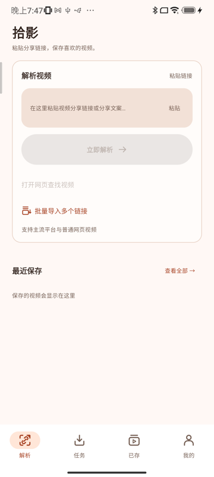

# 启动器快捷方式：打开页面不对（2026-10-12）

真机反馈：长按图标后的三个快捷方式里，**查看下载进度**正常，**批量导入**与**粘贴解析**"打开的页面不对"。
复现并定位到两处**导航缺陷**（与图标问题是两回事，见 `launcher-shortcut-icons-2026-10-12.md`）。

## 一、复现

```bash
# 先把应用停在「已存」页，再按启动器的方式投递快捷方式
adb shell am force-stop com.videodown.douyin.debug
adb shell am start -n com.videodown.douyin.debug/com.videodown.douyin.presentation.MainActivity
adb shell am start -a com.videodown.douyin.action.OPEN_LIBRARY -n …/MainActivity   # 切到已存
adb shell input keyevent KEYCODE_HOME
adb shell am start -a com.videodown.douyin.action.BATCH_IMPORT -n …/MainActivity
```

结果：**回到应用仍停在「已存」页，批量导入弹窗不出现**（见下图左）。

| 修复前（停在已存页，什么都没弹） | 修复后（弹窗出现） |
| :--- | :--- |
|  |  |

## 二、根因

`VideoDownApp` 里每个"目的地"标志都配了一段导航，唯独漏了两处：

| 标志 | 此前是否会跳转 |
| :--- | :--- |
| `openTasks`（查看下载进度） | ✅ `navigateTab(TASKS)` |
| `openLibrary` | ✅ `navigateTab(LIBRARY)` |
| `sharedText`（带链接进来） | ✅ `navigateTab(HOME)` |
| **`openBatchImport`（批量导入）** | ❌ **没有任何导航** |
| **`ACTION_QUICK_PARSE` 读不到链接时** | ❌ **不置 `sharedText`，于是也不跳转** |

- **批量导入**：`openBatchImport` 只被转发给「解析」页的 `HomeScreen`，而弹窗只在那一页存在。
  用户停在别的 tab 时，标志被设上但界面没动 → 什么都不发生；
  更糟的是标志一直挂着，**等他下次自己进解析页时会突然弹出来**。
- **粘贴解析**：只有当真的从剪贴板读到了链接才会（通过 `sharedText`）跳到解析页。
  读不到时（剪贴板为空、或被 MIUI 拦下）就**静默留在原地**——用户看到的就是"打开的不是解析页"。

## 三、修复

`presentation/MainActivity.kt`：

1. `VideoDownApp` 补上 `openBatchImport` 的导航：`if (openBatchImport && route != HOME) navigateTab(HOME)`；
   不再由这边消费标志，仍交给 `HomeScreen` 弹窗后消费。
2. 「粘贴解析」新增独立的 `openParsePage` 标志：快捷方式**无论能不能读到链接**都先记下"要去解析页"，
   由 `VideoDownApp` 跳转并消费；读不到链接时用户也落在解析页（还可在那里用粘贴/剪贴板提示）。

顺带修好了同一根因的另一条路径：**从设置页恢复备份里的链接**（`onImportLinks` 也靠 `openBatchImport`），
此前同样会停在设置页不弹窗。

## 四、验证

设备用例（`LauncherShortcutsDeviceTest`，新增 2 项；真机与模拟器各 **7/7** 通过）：

- `theBatchImportShortcutOpensTheDialogFromAnotherTab`：先切到「已存」页，再按启动器的方式投递
  `BATCH_IMPORT`，断言「批量链接导入」弹窗出现（修复前必红）。
- `theQuickParseShortcutLandsOnTheParsePageWithoutAClipboardLink`：清空剪贴板，从「已存」页投递
  `QUICK_PARSE`，断言落在解析页（修复前必红）。

投递方式与启动器一致：`context.startActivity(intent.addFlags(FLAG_ACTIVITY_NEW_TASK))`。
**没有**用 `ActivityScenario`：测试所在的 task 与应用自己的 task 不同，`startActivity` 会新起实例，
原实例被 PAUSE，收尾时等不到 `DESTROYED`（断言其实已经过了）——这一点在排查中踩实过。



## 五、未覆盖 / 边界

1. **没有 JVM 用例**：修复是纯 Compose 导航状态（`VideoDownApp` 的 `LaunchedEffect`），
   仓库目前没有能覆盖它的 JVM 测试架子；覆盖完全落在设备用例上。这是本条的明确缺口。
2. 剪贴板被 MIUI 拦截导致读不到链接的情形，只做到"不再静默留在原地"，**没有**额外的失败提示
   （落到解析页后可用粘贴按钮或剪贴板提示）。要更明确的反馈需要在解析页加一条消息。
3. 三个快捷方式在真机上的长按菜单本身仍无法用 adb 稳定唤出（见图标那篇的说明），
   所以验证走的是"启动器会发的那个 intent"，不是菜单点击。

---

# 追加：页面对了但输入框是空的（同日晚续）

真机反馈：快捷方式现在落到正确页面了，但**链接没有进输入框**。查出**两个互相独立**的原因。

## 原因一：读剪贴板时还没有输入焦点

Android 10+ 只允许**持有输入焦点**的应用读取剪贴板。快捷方式把应用拉到前台时焦点还没到手，
此刻读只能得到 `null`。真机实测（同一进程，投递前后各读一次）：

```
DIAG clip-before=null
DIAG clip-after=两条链接 https://example.com/one-diag01 https://example.com/two-
```

`粘贴解析` 早就为此有 `pendingQuickParse`（等 `onWindowFocusChanged` 再读），而 **`批量导入` 是当场读、没有重试**。
现在两条路径统一成 `pendingClipboardAction`：没焦点就记下动作，拿到焦点再读。

## 原因二：显式快捷方式复用了被动提示的严格策略

`MainActivity` 的显式读取此前走 `ClipboardLinkPolicy.candidate()`，而那条策略**只认已知平台**：

```kotlin
if (link.platform == VideoPlatform.GENERIC) return null   // 浏览器地址之类，不弹被动提示
```

对**被动**提示这规则是对的（别拿浏览器地址乱弹窗），但用户按下快捷方式就是明确要求解析。
现在显式路径接受**任何含 http(s) 链接的文本**（`VideoLinkExtractor.extract`），被动提示保持严格不变。

顺带补上：`批量导入` 会把剪贴板里的链接**预填**进导入框（复用恢复备份用的 `batchImportSeed` 通道），
"一次导入多个链接"不用再手动粘一次。

## 验证

设备用例（`LauncherShortcutsDeviceTest`，真机 **9/9**、模拟器 **9/9**）：

- `theQuickParseShortcutFillsTheInputForAPlainWebLink`（新增，修复前红）：普通网页链接也必须填进输入框。
- `theBatchImportShortcutCarriesTheClipboardLinksOnAColdStart`（新增）：**冷启动**投递 `BATCH_IMPORT`，
  断言剪贴板里的两条链接都进了导入框——冷启动才会真正经历"没焦点 → 等焦点"的顺序。
- 原有 7 条不变。

JVM 411 项 + `assembleDebug` 通过。

## 仍未覆盖

1. `粘贴解析` 在**完全读不到剪贴板**时（例如 MIUI 直接拦掉）仍只是落到解析页，**没有专门的失败提示**。
2. 我无法用 adb 伪造"别的应用写入的剪贴板"（`service call clipboard` 在 API 30 被拒），
   所以真机复现靠的是测试进程写入 + 焦点时序，与用户实际路径等价但来源不同。
3. 同上：真机长按菜单本身仍无法自动化，验证走的是启动器会发的那个 intent。

---

# 补充：三个快捷方式暂时下线（同日再续）

用户要求"把这三个功能先注释"。做法是**保留实现、停止发布**：

```kotlin
fun publish(context: Context) {
    // runCatching { ShortcutManagerCompat.setDynamicShortcuts(context, shortcuts(context)) }
    runCatching { ShortcutManagerCompat.removeAllDynamicShortcuts(context) }
}
```

关键点是**必须清掉已发布的动态快捷方式**：只把发布那行注释掉的话，升级安装后系统里仍留着历史条目，
长按菜单照旧显示——看起来像没生效。真机验证：

```bash
adb shell dumpsys shortcut | grep -A 12 "Package: com.videodown.douyin.debug"
# 该包下 ShortcutInfo 数量 = 0
```

保留未动的部分（都是为了随时恢复）：

- `LauncherShortcuts.shortcuts()` 的三个定义与 `ic_shiying_shortcut_*` 图标原样保留；
- `MainActivity` 里三个 action 的处理逻辑保留（这些 intent 路径的用例继续有效）；
- `ShortcutIconGuardTest`（JVM）继续盯住图标自带背景，恢复时不会又踩回"白线不可见"。

设备用例把"三个必须已发布"改成 `theEntryShortcutsAreTemporarilyNotPublished`（断言系统里一条都没有），
真机 9/9 通过。恢复步骤写在 `LauncherShortcuts.publish` 的注释里：把那行换回来，并把这条断言改回"三个都在"。
