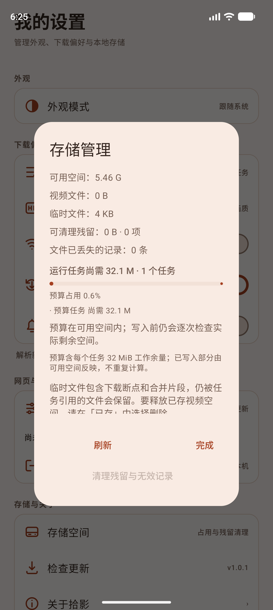
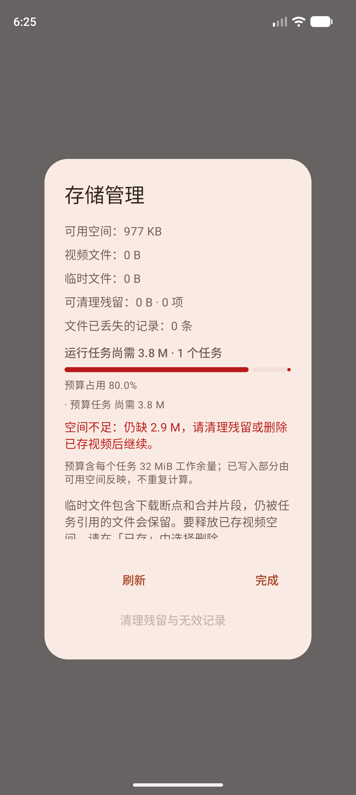
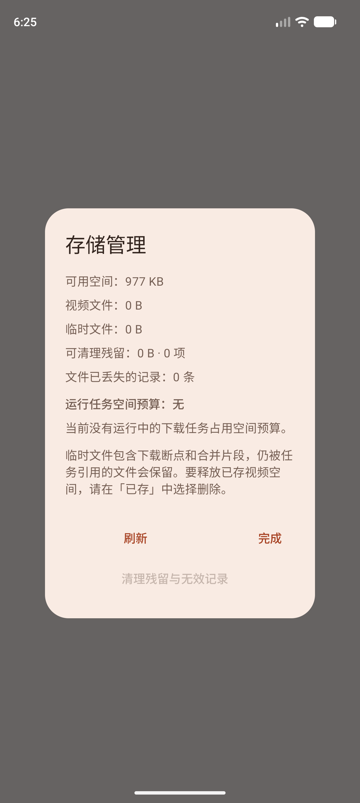

# 空间预算可视化验证（2026-10-09）

## 目标

存储界面此前只显示物理可用空间和视频/临时文件占用。剩余空间看似充足却仍然下载失败时，用户看不到「运行中的任务还要写多少」，也无法判断缺口。本轮把并发下载的空间预留账本可视化到「我的 → 存储空间」。

## 实现

- `domain/model/StorageUsage.kt` 新增 `StorageBudget` / `StorageBudgetEntry`，并挂在 `StorageUsage.budget`。`reservedBytes` 是运行任务尚未写入的字节；`shortfallBytes(available)` 给出缺口；`StorageUsage.budgetHeadroomBytes` 给出预算之外仍可用的空间。
- `data/download/StorageReservations.kt`：预留租约可带显示用 `label`；新增 `snapshot()` 只读视图，逐租约返回 `peakBytes - usedBytes`，与 `checkBudget` 的占用口径完全一致，避免展示值与准入值不一致。
- `DownloadEngine.storageBudget()`：把账本快照转成领域模型，按剩余字节降序排列，并用饱和加法求和，极端峰值不会回绕成小数字。
- `data/local/DownloadStorageRepository` 增加 `budget` 提供者并写入 `StorageUsage`；`ServiceLocator` 传入 `{ downloadEngine.storageBudget() }`，存储界面读到的始终是实时账本。
- `presentation/settings/StorageBudgetSummary.kt`：纯函数生成标题、缺口说明、占用比例和百分比文本；`StorageDialog.kt` 渲染预算标题、占用进度条、占用百分比、按剩余字节排序的任务明细（最多 4 条，其余折叠计数），预留超出可用空间时进度条和说明改为错误色并给出具体缺口。
- 语义：已写入的字节由可用空间反映，不重复计入预算；预算含每任务 32 MiB 工作余量，引擎任务含合并的第二份空间。界面文案明确这两点。

## 验证

执行：`:app:testDebugUnitTest :app:lintDebug :app:assembleDebug :app:assembleDebugAndroidTest`，随后在 Pixel_10_Pro(AVD)、Android API 37、arm64-v8a 上执行 `:app:connectedDebugAndroidTest`。

- 全量 JVM 单元测试 40 个类、245 项通过，0 失败、0 错误、0 跳过。
- 空间预算相关：`StorageReservationsTest` 7 项、`StorageBudgetSummaryTest` 4 项、`DownloadStorageRepositoryTest` 6 项、`P1DownloadIntegrationTest` 12 项全部通过。
- 新增覆盖：快照按任务返回未写入份额、写入后份额减少、关闭后消失、超额上报占用时不出现负数；`inspect()` 透传实时预算与余量/缺口；标题、缺口文案、比例与百分比、`Long.MAX_VALUE` 饱和、零可用空间。
- 集成覆盖：真实引擎下载运行中 `storageBudget()` 报出任务标题与正剩余，暂停释放后账本为空（`P1DownloadIntegrationTest`）。
- 真机/模拟器 UI 3 项通过：`storageDialogVisualizesTheRunningSpaceBudget`（真实引擎运行中打开存储对话框）、`overCommittedBudgetShowsTheShortfallAndAsksToFreeSpace`、`emptyLedgerExplainsThereIsNoRunningBudget`。
- Lint 无错误；Debug 应用与 Android 测试包构建成功。

截图证据：

- ：标题「运行任务尚需 32.1 M · 1 个任务」、进度条与「预算占用 0.6%」、「· 预算任务 尚需 32.1 M」、「预算在可用空间内」。
- ：红色进度条与「预算占用 80.0%」、红色「空间不足：仍缺 2.9 M，请清理残留或删除已存视频后继续。」。
- ：「运行任务空间预算：无」「当前没有运行中的下载任务占用空间预算。」。

原始结果见 [connected-results.txt](space-budget-device-2026-10-09/connected-results.txt)。

## 验证边界

- 物理可用空间与账本不是同一原子快照：`inspect()` 先读账本再读可用空间，极端并发下两者可能相差一次写入，但缺口展示只会偏保守，不会漏报已有预留。
- 真实磁盘被其他应用瞬间占满后，引擎会在下一次写入/周期检查时把任务判为 `STORAGE_FULL` 并释放预留；因此「缺口」状态在真机上通常只持续到下一次检查，截图通过固定账本的 UI 测试确定性验证，而非依赖真实填满磁盘。
- 本轮设备验证在模拟器完成，未使用 SHARK PRS-A0 真机；逻辑与并发账本窗口由 JVM 测试覆盖，真机视觉与此一致的可能性高，但未逐台复核。
- 账本只协调本应用的并发任务，不能阻止其他应用占用磁盘，也不改变既有的空间不足处理流程。
