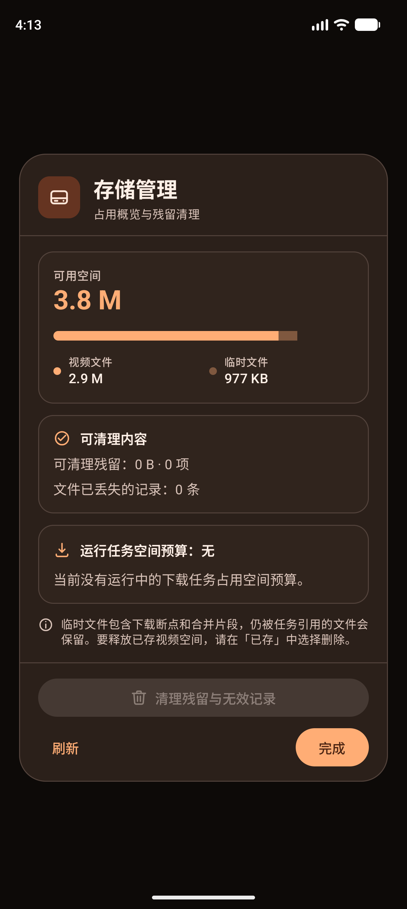
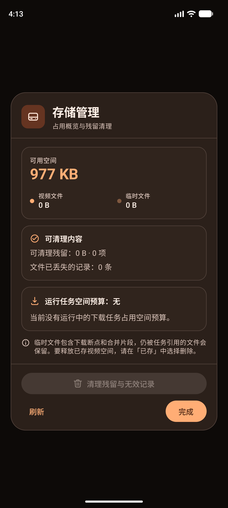
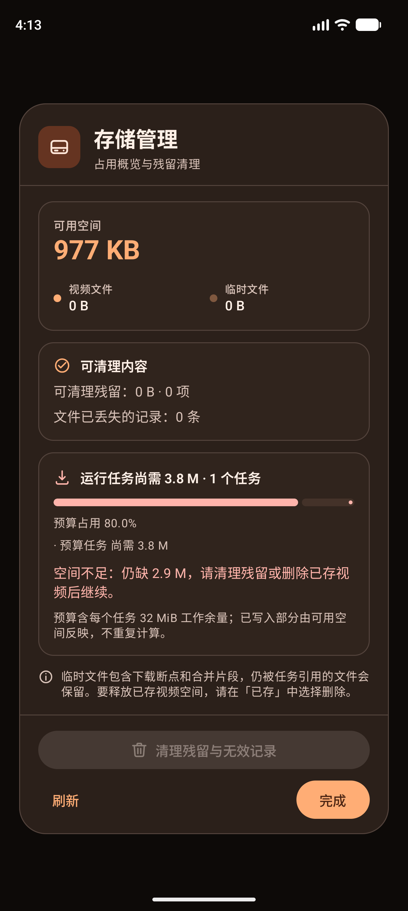
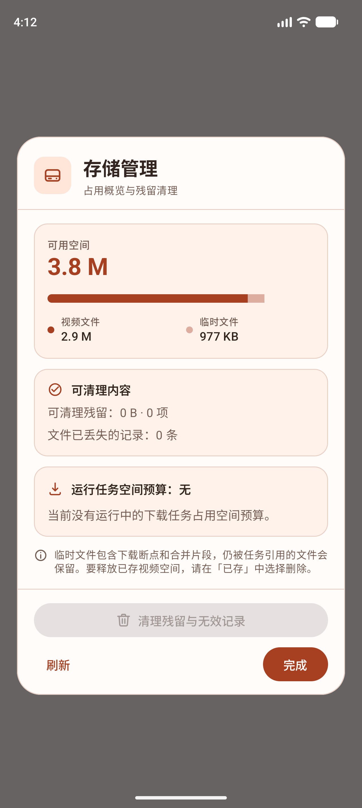
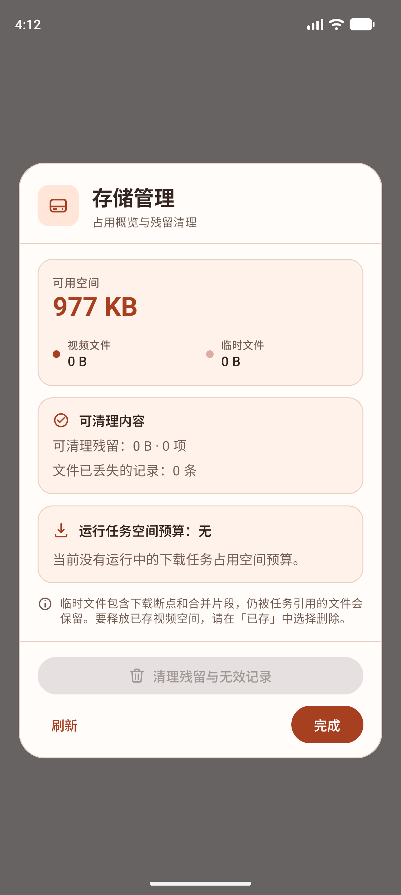

# 存储管理弹窗改版验证（2026-10-10）

## 目标

「我的 → 存储空间」的弹窗此前是一列同样字重、同样颜色的 `标签：数值`，可清理内容、运行任务预算、
说明文字与动作按钮之间没有层级；第一眼想看的「可用空间」夹在第五行才出现，动作行还把
「清理残留与无效记录」压在「完成」下面一行、且始终禁用态占位。

本轮把弹窗重做成卡片式布局：主数值在顶、占用比例成条、可清理内容独立成区、预算带状态色独立成卡，
动作行固定在底部。

## 实现

- `presentation/settings/StorageDialog.kt`：由 `AlertDialog` 文本列改为自定义 `Dialog` + `Surface`：
  - 标题区：`primaryContainer` 圆角图标块 + 「存储管理 / 占用概览与残留清理」。
  - 概览卡：「可用空间」作为 `headlineMedium` 主数值；应用占用（视频 + 临时）画成分段比例条，
    下方带色点图例；总占用为 0 时不画条，避免空条。
  - 可清理卡：标题带状态图标——无可清理项用完成图标、有则用警告图标并转错误色。
  - 预算卡：标题、进度条、占用百分比、逐任务明细、缺口说明、口径注释整卡收拢；缺口非 0 时
    标题图标、进度条与说明同转错误色。
  - 结果提示改为带图标与底色的横幅（成功用主色容器，失败用错误色容器）；忙碌态为「转圈 + 文案」。
  - 说明文字用 `bodySmall` + 信息图标，保持全屏最轻的一级。
  - 动作行：通栏 `FilledTonalButton`「清理残留与无效记录」（无可清理项时禁用但始终可见，回收站图标），
    下一行左「刷新」右「完成」（`Button`）。
- 高度策略：弹窗高度上限取当前窗口高度的 86%，正文列 `weight(1f, fill = false)` + `verticalScroll`——
  内容放得下就整段展示，放不下才封顶滚动，动作行始终留在屏幕内。
- `presentation/settings/StorageBudgetSummary.kt`：新增纯函数 `storageFootprintBytes`（两段占用求和并饱和）
  与 `storageShareFraction`（某段占比，0 空间或负数时返回 0）。
- `res/values/strings.xml`、`res/values-en/strings.xml`：新增 `storage_subtitle`、`storage_available_label`、
  `storage_videos_label`、`storage_temporary_label`、`storage_cleanup_section`；移除被替换掉的
  `storage_available` / `storage_videos` / `storage_temporary`。测试断言的
  `storage_reclaimable`、`storage_missing`、`storage_cleanup_action`、`storage_budget_*` 文案一字未改。

## 验证

执行（Emulator Pixel_10_Pro，Android API 37，arm64-v8a，emulator-5554）：

```bash
./gradlew :app:testDebugUnitTest --rerun-tasks                 # 387 项，0 失败
./gradlew :app:assembleDebug                                   # 成功
./gradlew :app:lintDebug                                       # 见「验证边界」
./gradlew :app:connectedDebugAndroidTest \
  -Pandroid.testInstrumentationRunnerArguments.class=<下列 4 个> \
  -Pandroid.injected.androidTest.leaveApksInstalledAfterRun=true
```

- JVM：全量 387 项通过。`StorageBudgetSummaryTest` 由 4 项增至 6 项，新增覆盖两段占用求和饱和、
  占比在 0 空间/负数/超额时落在 0..1。
- 设备（原始结果见 [connected-results.txt](storage-dialog-redesign-2026-10-10/connected-results.txt)）：
  - `SpaceBudgetDeviceTest` 3 项通过：新增 `overviewLeadsWithFreeSpaceAndNamesTheAppFootprint`
    断言新层级（「可用空间」「视频文件」「临时文件」「可清理内容」「清理残留与无效记录」「刷新」）；
    原有缺口与空预算两项断言未改仍通过。
  - `P1FeaturesDeviceTest#cleanupRequiresConfirmationAndPreservesVideosPausedAndActiveArtifacts` 通过：
    新按钮行仍可点、确认弹窗与清理结果（「文件已丢失的记录：0 条」）不变。
  - `P1FeaturesDeviceTest#storageDialogVisualizesTheRunningSpaceBudget` 通过：真实引擎运行中的预算卡仍按
    原有文案渲染。
  - `P1RecoveryNavigationDeviceTest#storageRecoveryOpensActualSettingsStorageDialog` 通过：下载失败恢复入口
    打开的仍是同一个存储弹窗。

截图证据（改版前对照：[空间预算验证](space-budget-device-2026-10-09.md) 的 `budget-empty-dialog.png`）：

- ：可用空间 3.8 M 作主数值，
  视频 2.9 M（实色）与临时 977 KB（同色 38% 透明）成条并带图例。
- ：可清理内容为 0 时用完成图标；
  预算卡标题带下载图标与「运行任务空间预算：无」；动作行通栏清理按钮（禁用）+「刷新/完成」。
- ：预算卡转错误色，
  红色进度条「预算占用 80.0%」、「空间不足：仍缺 2.9 M…」整段可见，未再出现文字被横向截断。
- 、
  ：浅色品牌配色下同一布局。

## 验证边界

- **未跑全量设备套件**：本轮只跑与存储弹窗直接相关的 3 个类/方法加新增 1 项，其余 40 余项设备测试未重跑；
  改动只落在 `StorageDialog.kt`、`StorageBudgetSummary.kt` 与 `strings.xml` 的存储段。
- **lint 未转绿，但与本轮无关**：`lintDebug` 报 53 个错误、138 个警告，全部落在本轮未改的文件
  （`VaultAuthenticator.kt`、`SettingsScreen.kt`、`PlayerScreen.kt`、`LibraryScreen.kt` 等）；
  `StorageDialog.kt` 与 `StorageBudgetSummary.kt` 零错误。改造中一度新增的
  `ConfigurationScreenWidthHeight` 警告已通过在窗口容器高度上取上限消除。
- **截图采集路径变了**：Android 15 起 `adb shell` 读不到应用外部目录，`SpaceBudgetDeviceTest.capture()`
  改为写入被测应用内部目录，用 `run-as com.videodown.douyin.debug cat` 取出；`P1FeaturesDeviceTest`
  的 `captureScreenshot()` 仍走外部目录，本轮未改，其截图在本机取不出来。
- **百分比与色调为纯视觉**：分段比例条只画「视频 / 临时」两段，不拆分可清理残留（它是临时文件的子集），
  因此比例条不等于磁盘占用全貌；文案未声称这一点。
- 弹窗高度依赖当前窗口高度：分屏或小屏下正文会滚动（动作行仍在屏内），本轮只在 1280×2856、480dpi
  的模拟器上目视确认。
